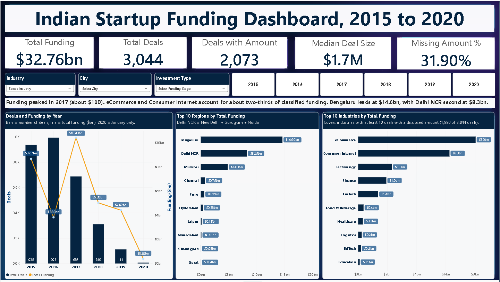
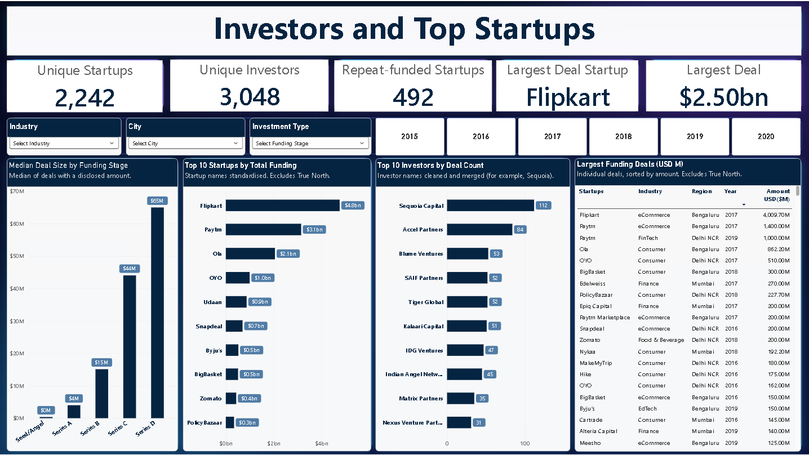
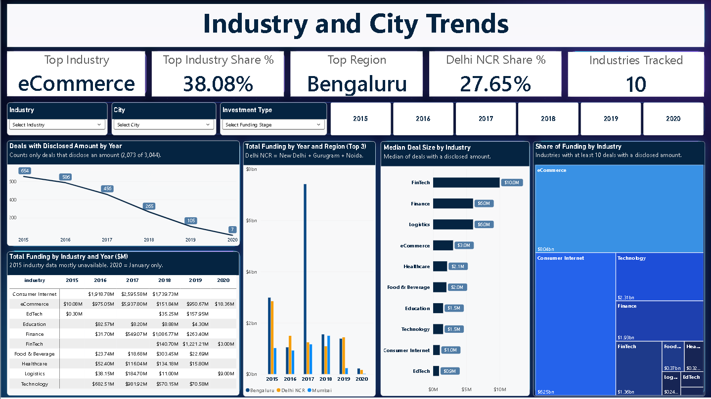
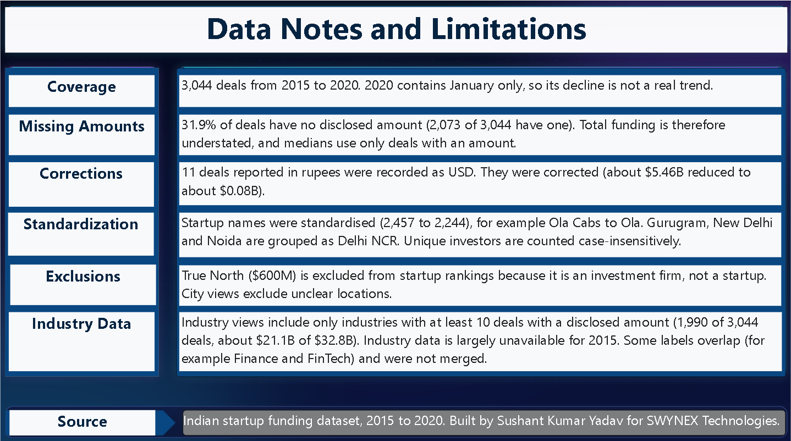

<div align="center">

# Indian Startup Funding: Interactive Power BI Dashboard

**SWYNEX Technologies · Data Analyst Internship · Task 3**


-5C2D91)


*A four-page interactive dashboard that turns the cleaned and audited Indian startup-funding data (3,044 deals, 2015 to January 2020) into a story about time, industries, cities, investors and startups, with the data limitations stated on the dashboard itself.*

</div>

---

## Video Walkthroughs

| Task | Video |
|---|---|
| Task 1: Data Cleaning & Preparation | [Watch on YouTube](https://youtu.be/Uq-i0Zj4JNo) |
| Task 2: Exploratory Data Analysis | [Watch on YouTube](https://youtu.be/YpbkOTyGYrM) |
| Task 3: Power BI Dashboard | [Watch on YouTube](https://youtu.be/1yWATsmKJFY) |

---

## Table of Contents
1. [Project Overview](#1-project-overview)
2. [Dashboard Preview](#2-dashboard-preview)
3. [Dataset](#3-dataset)
4. [Repository Structure](#4-repository-structure)
5. [Data Model](#5-data-model)
6. [Dashboard Pages in Detail](#6-dashboard-pages-in-detail)
7. [DAX Measures](#7-dax-measures)
8. [Key Insights](#8-key-insights)
9. [Design & Analytical Decisions](#9-design--analytical-decisions)
10. [Limitations](#10-limitations)
11. [How to Use](#11-how-to-use)
12. [Key Learnings](#12-key-learnings)
13. [Next Steps](#13-next-steps)
14. [Project Series](#14-project-series)
15. [Author](#15-author)

---

## 1. Project Overview

**Objective:** Build an interactive dashboard that lets a reader explore Indian startup funding without opening a notebook: how funding moved over time, which industries and cities attract the most money, who the most active investors are, and which startups raised the largest amounts.

**Approach:** This is the third and final stage of a single pipeline:

| Task | Stage | Output |
|---|---|---|
| Task 1 | Data cleaning & preparation (Python, pandas) | `cleaned_startup_funding.csv` |
| Task 2 | Exploratory data analysis, outlier audit and corrections (Python) | `startup_funding_eda.csv` |
| **Task 3** | **Interactive dashboard (Power BI, DAX)** | **`Indian_Startup_Funding_Dashboard.pbix`** |

The dashboard reads the Task 2 output directly. All business logic (totals, medians, shares, rankings, "top" cards) is written as **DAX measures**, so every number on the report reacts to the slicers instead of being hard-coded.

**Outcome:**
- **4 report pages** (Overview, Investors & Startups, Industry & City Trends, Data Notes & Limitations) in a consistent navy theme.
- **18 DAX measures** covering totals, medians, data-quality indicators, rankings and dynamic "top" cards.
- **Shared slicers** on Industry, City, Investment Type and Year on the three analysis pages.
- A dedicated **Data Notes & Limitations page**, so a reader sees the caveats (missing amounts, January-only 2020, corrected rows, exclusions) next to the charts and not only in a document.

---

## 2. Dashboard Preview

### Page 1: Overview


### Page 2: Investors and Top Startups


### Page 3: Industry and City Trends


### Page 4: Data Notes and Limitations


> The full report is also available as a PDF export (`Indian_Startup_Funding_Dashboard.pdf`). Slicers and cross-filtering work only in the `.pbix` file opened in Power BI Desktop.

---

## 3. Dataset

| Property | Detail |
|---|---|
| Source | Kaggle Indian startup funding dataset, cleaned in Task 1 and audited in Task 2 |
| Fact file | `startup_funding_eda.csv` (3,044 rows × 16 columns) |
| Investor file | `investors_clean.csv` (5,571 rows × 2 columns: `sr_no`, `investor`) |
| Period covered | 2 January 2015 to 13 January 2020 |
| Deals with a disclosed amount | 2,073 of 3,044 (68.1%) |
| Total disclosed funding | **$32.76B** (after the 11 corrections from Task 2) |
| Content | Funding rounds of Indian startups: date, company, industry, city, investors, round type, amount in USD |

### What happened to the data before it reached Power BI

| Stage | What was done |
|---|---|
| Task 1 | Dates and amounts converted to proper types, city / investment-type / industry labels standardised, encoding junk decoded, missing text labelled |
| Task 2 | Outliers detected inside each investment type (IQR rule, multiplier 3), **11 wrong amounts corrected** against public news reports (about $5.46B reduced to about $0.08B), startup names merged (2,457 to 2,242 distinct), city typos merged into `city_clean` |
| Task 3 | Investor column split into one row per investor (`investors_clean.csv`), calculated columns for region and "keep / exclude" flags, DAX measures, report design |

The original and the corrected amount are both kept in the fact table (`amount_original`, `amount_usd`, `amount_fixed`), so every correction can be audited.

---

## 4. Repository Structure

```
SWYNEX-Interactive-Dashboard/
├── Indian_Startup_Funding_Dashboard.pbix    # Power BI report (open in Power BI Desktop)
├── Indian_Startup_Funding_Dashboard.pdf     # Static 4-page export of the report
├── startup_funding_eda.csv                  # Fact table: 3,044 deals × 16 columns (Task 2 output)
├── investors_clean.csv                      # Investor table: one row per investor per deal
├── screenshots/
│   ├── Page_1_Overview.png
│   ├── Page_2_Investors_and_Startups.png
│   ├── Page_3_Industry_and_City_Trends.png
│   └── Page_4_Data_and_Limitations.png
├── README.md                                # This document
└── LICENSE                                  # MIT license
```

---

## 5. Data Model

The model has **two tables**.

| Table | Rows | Grain | Role |
|---|---:|---|---|
| `funding` | 3,044 | One row per funding deal | Fact table: amounts, dates, startup, industry, city, round type. Holds all measures except the two investor measures |
| `investors` | 5,571 | One row per investor per deal | Created because one deal can list several investors. Lets every investor get credit for every deal they joined |

**Relationship:** `investors[sr_no]` (many) to `funding[sr_no]` (one). Because of this relationship, `RELATED(funding[amount_usd])` can be used from the investor side, and an Industry / City / Year / Round slicer filters the investor ranking as well.

Only 2,859 of the 3,044 deals name at least one investor in `investors_clean.csv`; the rest are `Undisclosed`.

### Calculated columns used by the report

| Column | Table | Purpose |
|---|---|---|
| `Region` | `funding` | Groups `city_clean` into regions. **Delhi NCR = New Delhi + Gurugram + Noida**; every other city keeps its own name |
| `City Type` | `funding` | `Keep` for recognised cities, so city views exclude unclear locations (for example `Unknown`, a country or a state used as a city) |
| `Industry Type` | `funding` | `Keep` for industries with **at least 10 deals with a disclosed amount**, so industry medians rest on enough data |
| `startup_clean` | `funding` | Startup name with spelling variants merged in Task 2 (for example `Ola Cabs` to `Ola`) |
| `year` | `funding` | Year taken from `date`, used on every time axis and in the Year slicer |

---

## 6. Dashboard Pages in Detail

All pages share the same four controls: an **Industry** dropdown, a **City** dropdown, an **Investment Type** (funding stage) dropdown and a row of **Year buttons (2015 to 2020)**. The Industry slicer uses only industries marked `Keep`, and the City slicer uses only cities marked `Keep`.

### Page 1: Overview
*"What does Indian startup funding look like at a glance?"*

| Element | Detail |
|---|---|
| KPI cards | Total Funding **$32.76bn** · Total Deals **3,044** · Deals with Amount **2,073** · Median Deal Size **$1.7M** · Missing Amount % **31.90%** |
| Headline text | Funding peaked in 2017 (about $10B). eCommerce and Consumer Internet account for about two-thirds of classified funding. Bengaluru leads at $14.6bn, with Delhi NCR second at $8.3bn |
| Deals and Funding by Year | Combo chart: bars = number of deals, line = total funding ($bn). 2020 = January only |
| Top 10 Regions by Total Funding | Bengaluru $14.60bn, Delhi NCR $8.26bn, Mumbai $4.83bn, Chennai $0.76bn, Pune $0.62bn and five more |
| Top 10 Industries by Total Funding | eCommerce $8.0bn, Consumer Internet $6.3bn, Technology $2.3bn, Finance $1.9bn, FinTech $1.4bn and five more |

The Missing Amount % card sits next to Total Funding on purpose: the reader sees how complete the total is before trusting it.

### Page 2: Investors and Top Startups
*"Who funds, and who gets funded?"*

| Element | Detail |
|---|---|
| KPI cards | Unique Startups **2,242** · Unique Investors **3,048** · Repeat-funded Startups **492** · Largest Deal Startup **Flipkart** · Largest Deal **$2.50bn** |
| Median Deal Size by Funding Stage | Seed/Angel (under $1M) → Series A **$4M** → Series B **$15M** → Series C **$44M** → Series D **$65M**. Shown only for stages with enough deals; Private Equity is left out because it is a mixed group |
| Top 10 Startups by Total Funding | Flipkart $4.8bn, Paytm $3.1bn, Ola $2.1bn, OYO $1.0bn, Udaan $0.9bn, Snapdeal $0.7bn, Byju's $0.5bn, BigBasket $0.5bn, Zomato $0.4bn, PolicyBazaar $0.3bn. True North is excluded |
| Top 10 Investors by Deal Count | Sequoia Capital 112, Accel Partners 84, Blume Ventures 53, SAIF Partners 52, Tiger Global 52, Kalaari Capital 51, IDG Ventures 47, Indian Angel Network 45, Matrix Partners 35, Nexus Venture Partners 31 |
| Largest Funding Deals table | Startup, industry, region, year and amount in USD millions, sorted by amount. True North is excluded |

### Page 3: Industry and City Trends
*"Where is the money, and how has it moved?"*

| Element | Detail |
|---|---|
| KPI cards | Top Industry **eCommerce** · Top Industry Share **38.08%** · Top Region **Bengaluru** · Delhi NCR Share **27.65%** · Industries Tracked **10** |
| Deals with Disclosed Amount by Year | Line chart: 654 (2015), 586, 456, 265, 105, 7 (2020). Shows that disclosure itself falls over time |
| Total Funding by Year and Region (Top 3) | Clustered columns for Bengaluru, Delhi NCR and Mumbai. 2017 is dominated by Bengaluru (Flipkart) |
| Median Deal Size by Industry | FinTech $10.0M, Finance $6.0M, Logistics $6.0M, eCommerce $3.0M, Healthcare $2.1M, Food & Beverage $2.0M, Education $1.5M, Technology $1.5M, Consumer Internet $1.0M, EdTech $0.9M |
| Share of Funding by Industry | Treemap: eCommerce $8.04bn, Consumer Internet $6.25bn, Technology $2.31bn, Finance $1.93bn, FinTech $1.36bn and smaller blocks |
| Total Funding by Industry and Year ($M) | Matrix of the ten industries by year. 2015 industry data is mostly unavailable and 2020 = January only |

### Page 4: Data Notes and Limitations
*"What should a reader be careful about?"*

A text-only page that documents coverage, missing amounts, the 11 corrections, standardisation, exclusions and the industry filter, with the data source line. See [Limitations](#10-limitations).

---

## 7. DAX Measures

18 measures: 16 on the `funding` table and 2 on the `investors` table. All are plain DAX with no hidden helper tables.

### 7.1 Core measures

```dax
Total Funding = SUM ( funding[amount_usd] )
```
Sum of all disclosed amounts. Blank amounts are ignored, which is why this total is understated (see Missing Amount %).

```dax
Total Deals = COUNTROWS ( funding )
```
Every deal, with or without an amount.

```dax
Deals with Amount = COUNT ( funding[amount_usd] )
```
`COUNT` only counts non-blank numbers, so this is the number of deals that disclose an amount (2,073).

```dax
Median Deal Size = MEDIAN ( funding[amount_usd] )
```
The median is used next to the total because a few very large deals pull totals and averages far above the typical deal (mean about $15.8M against a median of $1.7M).

```dax
Missing Amount % =
DIVIDE ( [Total Deals] - [Deals with Amount], [Total Deals] )
```
Share of deals with no disclosed amount (31.90%). `DIVIDE` returns blank instead of an error when a slicer selection has no deals.

### 7.2 Startup measures

```dax
Startup Funding =
CALCULATE (
    [Total Funding],
    KEEPFILTERS ( funding[startup_clean] <> "True North" )
)
```
Total funding with **True North ($600M) excluded**, because it is a private-equity fund raise and not funding received by a startup. `KEEPFILTERS` makes the exclusion add to the visual's existing filters instead of replacing the startup on each bar. Used by the Top 10 Startups chart.

```dax
Unique Startups = DISTINCTCOUNT ( funding[startup_clean] )
```
Distinct startups after name standardisation (2,242).

```dax
Largest Deal = MAX ( funding[amount_usd] )
```
Largest single disclosed amount ($2.50bn, Flipkart, August 2017).

```dax
Largest Deal Startup =
VAR m = MAX ( funding[amount_usd] )
RETURN
    CALCULATE ( MAX ( funding[startup_clean] ), funding[amount_usd] = m )
```
Finds the largest amount in the current filter context, then returns the startup that raised it. Updates with every slicer.

```dax
Repeat-funded Startups =
COUNTROWS (
    FILTER (
        VALUES ( funding[startup_clean] ),
        CALCULATE ( COUNTROWS ( funding ) ) > 1
    )
)
```
Number of startups that appear in more than one funding round (492). `VALUES` lists each startup once, and the inner `CALCULATE` counts that startup's deals.

### 7.3 Investor measures

```dax
Investor Deals = COUNTROWS ( investors )
```
Number of investor-deal rows in the current filter context, so each investor gets credit for every deal they joined.

```dax
Unique Investors = DISTINCTCOUNT ( investors[investor] )
```
Distinct investors (3,048, counted case-insensitively).

```dax
Investor Rank Score =
[Investor Deals]
    + DIVIDE ( SUMX ( investors, RELATED ( funding[amount_usd] ) ), 1e13 )
```
A **ranking tie-breaker**. The score is the deal count plus a tiny fraction taken from the money involved: the funding of every deal the investor joined, divided by 10^13 so it can never add up to a whole deal. Two investors with the same deal count are therefore ordered by the funding of their deals, and the order is stable instead of random. The Top 10 Investors chart is sorted by this score, but the bars show `Investor Deals`.

### 7.4 Industry and region measures

These "top" measures are **dynamic**: the card text changes when a slicer changes.

```dax
Top Industry =
VAR t =
    TOPN (
        1,
        CALCULATETABLE ( VALUES ( funding[industry] ), funding[Industry Type] = "Keep" ),
        [Total Funding], DESC
    )
RETURN
    MAXX ( t, funding[industry] )
```
The industry with the highest funding among the industries that pass the 10-deal rule.

```dax
Top Industry Share % =
VAR topInd = [Top Industry]
RETURN
    DIVIDE (
        CALCULATE ( [Total Funding], funding[industry] = topInd ),
        CALCULATE ( [Total Funding], funding[Industry Type] = "Keep" )
    )
```
Funding of the top industry divided by the funding of all kept industries (eCommerce is **38.08%** of about $21.1B). The denominator is the classified total, not the $32.76B grand total.

```dax
Industries Tracked =
CALCULATE ( DISTINCTCOUNT ( funding[industry] ), funding[Industry Type] = "Keep" )
```
Number of industries that pass the 10-deal rule (10).

```dax
Top Region =
VAR t =
    TOPN (
        1,
        CALCULATETABLE ( VALUES ( funding[Region] ), funding[City Type] = "Keep" ),
        [Total Funding], DESC
    )
RETURN
    MAXX ( t, funding[Region] )
```
The region with the highest funding among recognised cities (Bengaluru).

```dax
Delhi NCR Share % =
DIVIDE (
    CALCULATE ( [Total Funding], funding[Region] = "Delhi NCR" ),
    CALCULATE (
        [Total Funding],
        REMOVEFILTERS ( funding[Region] ),
        funding[City Type] = "Keep"
    )
)
```
Delhi NCR funding divided by funding of all recognised cities (**27.65%**). `REMOVEFILTERS ( funding[Region] )` keeps the denominator as "all regions", so the share stays meaningful even when a single region is selected.

### 7.5 Measures and the visuals that use them

| Visual | Measures used |
|---|---|
| Overview KPI cards | Total Funding, Total Deals, Deals with Amount, Median Deal Size, Missing Amount % |
| Deals and Funding by Year | Total Deals, Total Funding |
| Top 10 Regions / Industries | Total Funding with `Region` / `industry` on the axis |
| Investors page KPI cards | Unique Startups, Unique Investors, Repeat-funded Startups, Largest Deal Startup, Largest Deal |
| Median Deal Size by Funding Stage / Industry | Median Deal Size |
| Top 10 Startups | Startup Funding |
| Top 10 Investors | Investor Deals (bars), Investor Rank Score (sort order) |
| Industry & City page KPI cards | Top Industry, Top Industry Share %, Top Region, Delhi NCR Share %, Industries Tracked |
| Deals with Disclosed Amount by Year | Deals with Amount |
| Funding by Year and Region / Matrix / Treemap | Total Funding |

---

## 8. Key Insights

| # | Insight |
|---|---|
| 1 | **2017 was the peak year for money, 2016 the peak for deal count.** 993 deals in 2016 raised $3.83B; 687 deals in 2017 raised $10.43B, driven by a few very large rounds. |
| 2 | **Fewer, larger deals.** Deals fall from 936 (2015) to 111 (2019), while the median deal size rises (see Task 2: $1.0M in 2016 to $6.2M in 2019). |
| 3 | **Funding is concentrated by industry.** eCommerce ($8.0bn) and Consumer Internet ($6.3bn) account for about two-thirds of classified funding; eCommerce alone is 38.08%. |
| 4 | **Bengaluru leads by money, Delhi NCR is second.** Bengaluru raised $14.6bn; Delhi NCR (New Delhi + Gurugram + Noida) raised $8.3bn, which is 27.65% of funding in recognised cities. |
| 5 | **Stage drives deal size.** The median grows from under $1M (Seed/Angel) to $4M (Series A), $15M (Series B), $44M (Series C) and $65M (Series D). |
| 6 | **Typical deal size differs by industry.** FinTech has the highest median ($10.0M), followed by Finance and Logistics ($6.0M each). Consumer Internet has the most deals but a $1.0M median: many small deals. |
| 7 | **A few startups take a large share.** Flipkart ($4.8bn), Paytm ($3.1bn) and Ola ($2.1bn) lead the startup ranking. |
| 8 | **Most active investors.** Sequoia Capital (112 deals) and Accel Partners (84) are far ahead of the rest of the top 10. |
| 9 | **Repeat funding is common.** 492 of 2,242 startups (about 22%) raised more than one round. |
| 10 | **Disclosure is uneven.** 31.90% of deals have no amount. Disclosed deals fall from 654 (2015) to 105 (2019), so early-year totals are understated more than later ones. |

---

## 9. Design & Analytical Decisions

- **Dashboard flow: summary → detail → caveats.** Page 1 answers "how big and how complete", Page 2 "who", Page 3 "where and when", and Page 4 "how far can this be trusted".
- **Measures instead of hard-coded numbers.** Every KPI and "top" card is a DAX measure, so it recalculates for any slicer selection.
- **Median next to the total.** Money data is heavily skewed; the median shows the typical deal, the total shows the scale.
- **Missing amounts are shown, not hidden.** `Missing Amount %` is a headline KPI, and charts that count deals say whether they count all deals or only deals with an amount.
- **No imputation.** An undisclosed amount is a real fact, not an error. Filling it with an average would invent money that was never raised.
- **Minimum sample rule.** Industry views use only industries with at least 10 deals that disclose an amount (1,990 of 3,044 deals, about $21.1B of $32.8B), so one-off labels do not distort medians.
- **Delhi NCR as one region.** New Delhi, Gurugram and Noida are one metropolitan market, so they are grouped (other nearby cities such as Faridabad are not included).
- **True North excluded from startup rankings.** It is a $600M fund raise, not startup funding. It stays in the overall total.
- **Corrected amounts are used, originals are kept.** The 11 rupee-as-USD errors fixed in Task 2 would otherwise have added about $5.4B and made a $3.9B Rapido round the "largest deal".
- **Investor ranking built on a separate table.** Splitting investors into their own table gives each investor credit for every deal, and the tie-breaker keeps the order stable.
- **Consistent visual language.** Dark navy headers, one bar colour, value labels on every bar, and chart subtitles that state the filter rule (for example "Median of deals with a disclosed amount").
- **Reader-friendly navigation.** Year buttons for one-click time filtering, plus Industry, City and Investment Type dropdowns on every analysis page.

---

## 10. Limitations

These are also written on Page 4 of the dashboard.

- **Coverage:** 3,044 deals from 2015 to 2020. **2020 contains January only** (7 deals), so its decline is not a real trend.
- **Missing amounts:** 31.9% of deals (971) have no disclosed amount. Total funding is therefore understated, and medians use only deals with an amount.
- **Corrections:** 11 deals reported in rupees were recorded as USD and were corrected using public news reports (about $5.46B reduced to about $0.08B). Rupee conversions are approximate (Rs 71 to 72 per USD), and smaller cases of the same error may remain.
- **Standardisation:** Startup names were standardised (2,457 raw to 2,242 distinct, for example Ola Cabs to Ola). Gurugram, New Delhi and Noida are grouped as Delhi NCR. Unique investors are counted case-insensitively. Names that use different words, and investor labels that join two investors, may still be split.
- **Exclusions:** True North ($600M) is excluded from startup rankings because it is an investment firm, not a startup. City views exclude unclear locations.
- **Industry data:** Industry views include only industries with at least 10 deals with a disclosed amount (1,990 of 3,044 deals). Industry data is largely unavailable for 2015. Some labels overlap (for example Finance and FinTech) and were not merged.
- **Private Equity** is a mixed group (some rows may be fund raises), so its median is not comparable with the numbered rounds and it is left out of the stage chart.
- **Series E to J** have only 1 or 2 deals each, so their medians are not reliable and are not shown.
- **Data collection:** The fall in the number of deals after 2016 may partly reflect how the data was collected and not only the market.

---

## 11. How to Use

**Option A: View only**
1. Open `Indian_Startup_Funding_Dashboard.pdf` for a static copy of all four pages, or look at the images in `screenshots/`.

**Option B: Interactive**
1. Install **Power BI Desktop** (free, Windows).
2. Clone or download this repository.
3. Open `Indian_Startup_Funding_Dashboard.pbix`.
4. If Power BI asks for the data source, go to **Home → Transform data → Data source settings** and point `startup_funding_eda.csv` and `investors_clean.csv` to your local copies.
5. Use the Industry, City and Investment Type dropdowns and the Year buttons. Click a bar, treemap block or table row to cross-filter the other visuals; click it again to clear the filter.

**Requirements:** Power BI Desktop (any recent version).

---

## 12. Key Learnings

- **A dashboard is only as honest as its data.** The Task 2 correction of 11 amounts changed the headline total by about $5.4B, so the audit mattered more than any chart choice.
- **Put the caveat on the dashboard.** A Data Notes page and subtitles on the charts keep the limitations in front of the reader.
- **Measures beat calculated columns for business logic.** Totals, shares and "top" cards respond to every slicer; a column would be fixed at refresh.
- **Context is everything in DAX.** `KEEPFILTERS`, `REMOVEFILTERS`, `VALUES` and `CALCULATETABLE` decide what a number means once slicers are applied. The same measure gives a different answer in a card, a bar and a matrix cell.
- **Separate the many-to-many.** Moving investors into their own table made the investor ranking correct and the model easy to read.
- **Small design choices change the message.** Showing the median beside the total, and the disclosed-deal count beside the deal count, prevents wrong conclusions.

---

## 13. Next Steps

- Merge the remaining overlapping industry labels (for example Finance and FinTech, EdTech and Education) for a cleaner segmentation.
- Add a "disclosed amount" indicator to charts so partial totals are not read as complete.
- Add a detail page for a single startup or investor (drill-through).
- Publish the report to Power BI Service for browser access.
- Verify the remaining Private Equity rows for fund raises that are not startup funding.

---

## 14. Project Series

| Task | Repository | Focus |
|---|---|---|
| Task 1 | [Data Cleaning & Preparation](https://github.com/Skysushant7366/SWYNEX-Data-Cleaning-Preparation) | Missing values, data types, inconsistent labels, encoding junk |
| Task 2 | [Exploratory Data Analysis](https://github.com/Skysushant7366/SWYNEX-Exploratory-Data-Analysis) | Outlier audit, 11 corrections, six analyses |
| **Task 3** | **This repository** | **Interactive Power BI dashboard with DAX** |

---

## 15. Author

**Sushant Kumar Yadav**
Aspiring Data Analyst · B.Com (Hons), University of Delhi

LinkedIn: [www.linkedin.com/in/sushantkumaryadav310899](https://www.linkedin.com/in/sushantkumaryadav310899/)
GitHub: [Skysushant7366](https://github.com/Skysushant7366)
Portfolio: [https://skysushant7366.github.io/Sushant-portfolio/](https://skysushant7366.github.io/Sushant-portfolio/)
*Completed as Task 3 of the Data Analyst Internship at SWYNEX Technologies.*
